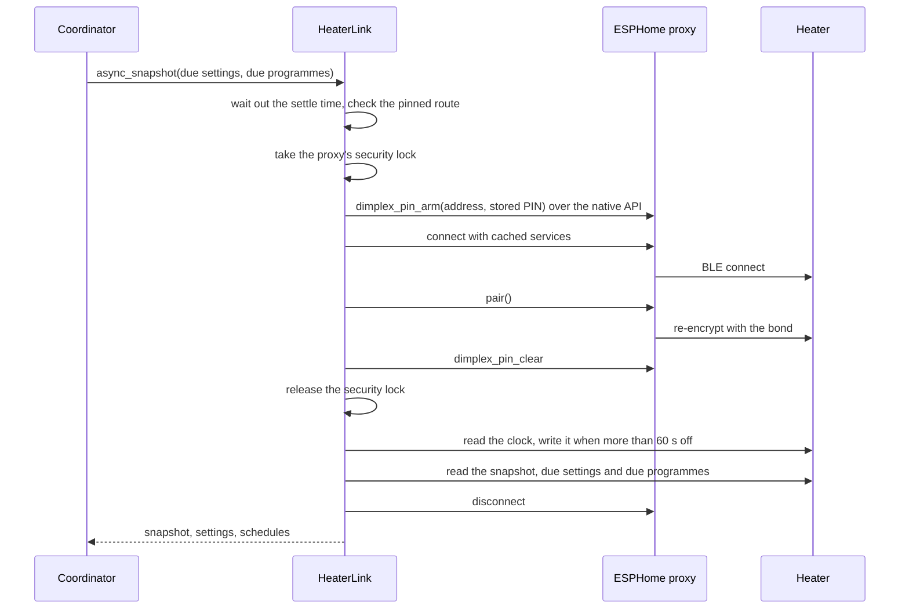
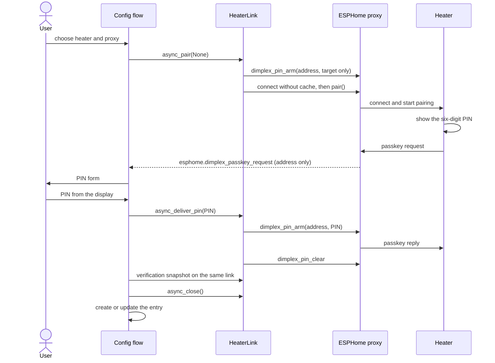

# Architecture

Dimplex BLE is a Home Assistant custom integration that controls Dimplex panel heaters over Bluetooth Low Energy (BLE). Home Assistant never reaches a heater directly: every operation runs through one ESPHome Bluetooth proxy that holds the heater's bond and answers its personal identification number (PIN) request. Each operation connects, pairs, works and disconnects, so no link stays open between polls.

## Terms used on this page

The page uses a small vocabulary for the parts of the system:

- **Heater**: a Dimplex panel heater that advertises `AL####` or `AM####`, optionally followed by `<Dimplex>`
- **Proxy**: an ESP32 running ESPHome's Bluetooth proxy plus the PIN responder package
- **Responder**: the `ble_client` in [`firmware/dimplex_pin_responder.yaml`](../../firmware/dimplex_pin_responder.yaml) that answers the heater's passkey request
- **Bond**: the long-term key the proxy and the heater share after the first pairing
- **Link**: one Generic Attribute Profile (GATT) connection from Home Assistant, through the proxy, to the heater
- **Operation**: one connect, pair, GATT sequence and disconnect, run under the link's lock

## Config entries

The integration uses one config entry per heater and at most one shared "Dimplex" entry.

### Heater entries

A heater entry describes one heater and the proxy that holds its bond. Its `unique_id` is the heater's formatted media access control (MAC) address. Its data holds three keys:

- **`address`**: the heater's Bluetooth address
- **`proxy_source`**: the scanner source (Bluetooth MAC) of the pinned proxy
- **`passkey`**: the six-digit PIN from the heater display, absent when the proxy already held a bond at setup

Heater entries have no options flow. Reauthentication and reconfiguration run the pairing path again and update `proxy_source` and `passkey`.

### The Dimplex entry

The Dimplex entry holds settings that every heater shares. Its `unique_id` is `dimplex_settings` and its title is "Dimplex". The user adds it from the menu of the user step, which offers "heater" or "settings" while no Dimplex entry exists. It stores these values:

- **`refresh_token`** (data): the Dimplex sign-in token for firmware lookups, or none when the user did not sign in
- **`sync_clock`** (option): set heater clocks to Home Assistant's time, default on
- **`boost_minutes`** (option): length of the Boost preset, 1 to 240 minutes, default 60

The sign-in form takes an email address and a password. The integration keeps only the refresh token and drops the password. Only this entry has an options flow ([`config_flow.py`](../../custom_components/dimplex_ble/config_flow.py), `DimplexOptionsFlow`).

### How heaters read the shared settings

Heaters read the Dimplex entry directly, so the load order of entries does not matter. [`settings.py`](../../custom_components/dimplex_ble/settings.py) looks the entry up by its `unique_id` on each call and returns the defaults when it is missing. Setup of the Dimplex entry registers an update listener. The listener reloads every heater entry when the options change or when the sign-in appears or disappears. A renewed token alone reloads nothing. Adding the entry while Home Assistant runs also reloads every heater.

### Removal

Removing a heater entry deletes its two repair issues, its carried silence record and its schedule store file (`async_remove_entry` in [`__init__.py`](../../custom_components/dimplex_ble/__init__.py)). A device can be removed only while no connectable scanner hears the heater.

## Module map

Each Python module in `custom_components/dimplex_ble` has one job:

- **`__init__.py`**: sets up heater entries (link, coordinator, listeners, timers, device) and the Dimplex entry watcher, and cleans up on removal
- **`calendar.py`**: three read-only calendars of the timer programmes (User Timer, Home All Day, Out All Day)
- **`climate.py`**: the climate entity with Heat and Auto modes and the presets, including Boost and Away
- **`cloud.py`**: Dimplex cloud client for sign-in, firmware lookup and download
- **`config_flow.py`**: commissioning, reauthentication, reconfiguration, the proxy survey and the Dimplex options flow
- **`const.py`**: domain, configuration keys, intervals, platforms and the fixed entity `unique_id` suffixes
- **`coordinator.py`**: the per-heater `DataUpdateCoordinator`, slow reads, write paths and failure mapping
- **`datetime.py`**: the Away return time
- **`diagnostics.py`**: the redacted diagnostics export
- **`discovery.py`**: recognizes panel heater advertisement names
- **`entity.py`**: base entity, device info and `unique_id` construction
- **`errors.py`**: the integration's exception types and the mapping to Home Assistant errors
- **`firmware.py`**: the shared Dimplex account session and token renewal
- **`link.py`**: `HeaterLink`, the pinned route, settle wait, security lock, connect, pair, clock check, GATT operations and firmware flashing
- **`number.py`**: Away, Boost and Setback temperatures and the room temperature offset
- **`ota.py`**: firmware image checks and the over-the-air (OTA) frame sequence
- **`protocol.py`**: GATT addresses and byte encoding and decoding of every Dimplex parameter (see [protocol.md](protocol.md))
- **`responder.py`**: calls the proxy's PIN responder actions through the ESPHome native application programming interface (API) client and redacts the PIN from logs
- **`schedule_keeper.py`**: the schedule backup and the queue of schedule changes not yet written
- **`select.py`**: the display temperature unit
- **`sensor.py`**: diagnostic sensors, including estimated power and estimated energy
- **`services.py`**: the actions `set_schedule`, `get_schedule`, `restore_schedule` and `get_gatt_services`
- **`settings.py`**: reads the Dimplex entry and reloads heaters when it changes
- **`stall.py`**: `StallMonitor`, the stalled-heater repair
- **`switch.py`**: Sound, Setback, open window detection, pre-emptive heating and Advance
- **`update.py`**: the firmware update entity

The folder also holds `manifest.json` (Bluetooth matchers, dependencies on `bluetooth_adapters` and `esphome`), `services.yaml`, `icons.json`, `translations/en.json` and `brand/`.

## Connection model

Every operation opens its own link through the pinned proxy and closes it at the end. The decision to stop holding links followed repeated heater stalls on held links; see the 2026-11-25 entries in the [ledger](research/investigation-2026-11-24/ledger.md).

### Cadence

The coordinator polls every 60 seconds (`UPDATE_INTERVAL` in [`const.py`](../../custom_components/dimplex_ble/const.py)). Each poll is one operation, and slower reads ride on it:

- **Every poll**: the snapshot (room temperature, mode, setpoint, Away, Boost, error code, output and the other mapped fields)
- **Every 5 minutes and after a setting write**: the appliance id, Sound, Setback and the temperature offset (`SLOW_SETTINGS`)
- **Every 6 hours and after a failed schedule save**: the three timer programmes, seven days each
- **Every 12 hours**: the firmware lookup of the update entity, which uses the cloud and not the link

Slow settings stay due until every one of them was read. A failed settings read does not fail the poll, and it never suppresses the schedule read.

### One operation

`HeaterLink._operation` in [`link.py`](../../custom_components/dimplex_ble/link.py) runs every GATT sequence. It takes the link's lock, connects and pairs, runs the clock check when due, yields the client and disconnects on every outcome. A GATT error drops the link, starts the stall window and raises `HeaterUnavailableError`. Commands such as a setpoint write run as their own operation and do not wait for the next poll.

### Settle time

The heater needs 10 seconds of quiet after a link ends before it accepts a new one (`HEATER_SETTLE_S`). A shared registry keeps each heater's last link-down time, so a command right after a poll waits up to 10 seconds. The basis is two hardware reconnects within 23 ms that failed, plus Dimplex's own guidance ([findings](research/esphome-ble-findings.md#heater-settle-time)).

### Never abandon connect or pair

`connect()` and `pair()` run as their own tasks and always run to their native end, even when Home Assistant cancels the caller. Aborting a security procedure makes ESP-IDF, Espressif's development framework for the ESP32, delete the bond (RC-2). Cancelling a forming connect leaves a stale GATT record that refuses every connect until the proxy reboots (RC-3). Both root causes are in [esphome-ble-findings.md](research/esphome-ble-findings.md#verified-root-causes).

### Link reuse

Only the config flow reuses a link. `HeaterLink.async_pair` leaves the link open, and the flow's verification snapshot runs over it. `_ensure_link` reuses a client only while it is connected and was built on the current scanner object. At runtime every operation disconnects, so the next operation always connects again.

### Advertisements

Each heater registers a callback for every advertisement of its address, including identical repeats that change-driven callbacks skip. Any advertisement on any scanner proves the heater's radio works and clears the stall window. When the last poll failed and the advertisement came from the pinned proxy, the coordinator requests a refresh at once.

### A poll, step by step

The diagram shows one successful poll on a heater whose bond is intact:



The responder is armed before the connect and cleared after `pair()` ends, both under the proxy's security lock. With an intact bond `pair()` re-encrypts and the responder is never asked. With a lost bond the heater asks for its passkey, and the armed PIN re-creates the bond without user action. All GATT reads happen after the lock is released, so other heaters on the same proxy can pair meanwhile.

## Pairing and the PIN responder

ESPHome's native API has no passkey message, so a stock ESPHome package on the proxy answers the heater's PIN request. Home Assistant hands the PIN to that package immediately before it pairs.

### The firmware package

[`firmware/dimplex_pin_responder.yaml`](../../firmware/dimplex_pin_responder.yaml) uses stock components only. It keeps the PIN in a global that lives in memory only, where 1000000 means disarmed. Its core is the passkey handler:

```yaml
ble_client:
  - id: dimplex_pin_client
    mac_address: "00:00:00:00:00:00" # retargeted by dimplex_pin_arm
    auto_connect: false
    on_passkey_request:
      - homeassistant.event:
          event: esphome.dimplex_passkey_request
          data:
            address: !lambda "return std::string(id(dimplex_pin_client).address_str());"
      - wait_until:
          condition:
            lambda: "return id(dimplex_pin) <= 999999;"
          timeout: 25s # below the 30 s SMP response timer
      - if:
          condition:
            lambda: "return id(dimplex_pin) <= 999999 && (millis() - id(dimplex_pin_set_ms)) < 180000;"
          then:
            - ble_client.passkey_reply:
                id: dimplex_pin_client
                passkey: !lambda "return id(dimplex_pin);"
```

The handler first fires an event that carries only the heater address. It then waits up to 25 seconds for an armed PIN, which stays below the 30 second Security Manager Protocol (SMP) response timer. It replies only with a PIN armed in the last 3 minutes. Two API actions drive it:

- **`dimplex_pin_arm(address, passkey)`**: retargets the client at the heater and arms the PIN; 1000000 means "target only, the PIN follows"
- **`dimplex_pin_clear()`**: disarms the PIN and detaches the client

The package sets `io_capability: keyboard_only` and `max_connections: 4` (three proxy slots plus the responder) and requires ESPHome 2026.11.0 or newer. ESP-IDF's default authentication request is already `SC_MITM_BOND`: ESP-IDF 5.5.6 sets it in `bta_dm_co_security_param_init()` (`components/bt/host/bluedroid/bta/dm/bta_dm_co.c`), and ESPHome overrides it only when `auth_req_mode` is set. The package must be merged after the stock proxy package, whose `min_version` would otherwise win. It also extends the stock `ota_esphome` with `encryption: {}`: without it, ESPHome only offers OTA encryption and accepts unauthenticated plaintext uploads, and a replaced firmware could capture every PIN. The encryption inherits the `api` key, which must therefore be in the YAML rather than provisioned by Home Assistant at runtime. Tested on 2026-11-25 on the classic ESP32 test board: an unauthenticated plaintext upload succeeded before and was refused after; an encrypted upload with the key still succeeded. [`firmware/example-bluetooth-proxy.yaml`](../../firmware/example-bluetooth-proxy.yaml) shows a complete proxy.

### How Home Assistant arms the PIN

[`responder.py`](../../custom_components/dimplex_ble/responder.py) finds the loaded ESPHome config entry whose Bluetooth MAC equals the pinned scanner source. It calls the action on that entry's own `APIClient.execute_service`. It never uses `hass.services`, because a service call would put the PIN on the event bus and into the recorder. The event from the proxy to Home Assistant (`esphome.dimplex_passkey_request`) does travel on the event bus, but it carries no PIN.

### Keeping the PIN out of logs

aioesphomeapi logs every action it sends, with arguments, at DEBUG level. `_RedactPinFilter` on the `aioesphomeapi.connection` logger replaces the arguments of the arm action with `**REDACTED**`. The integration's own log lines say only `pin=set` or `pin=target-only`. Diagnostics redact the PIN with the address and proxy source. Hosts should still keep `aioesphomeapi.connection` at `info`.

### Ordering rules

Three rules govern every pairing, each backed by a hardware finding:

- **Arm before connect**: the heater starts SMP the moment the link is up, so a responder armed later misses the request (RC-5)
- **One security lock per proxy**: the proxy holds one responder state for all its heaters, so only the pairing that holds the lock may arm or clear it
- **Reauthentication only for SMP reason 81**: only reason 81 was observed for a wrong PIN; every other code stays transient

### An entry without a stored PIN

An entry created on a proxy that already held the bond stores no PIN. Such an entry listens for the passkey event from its own proxy. When the event arrives, the bond is gone and nothing can answer, so the entry starts reauthentication.

## Proxy pinning and proxy choice

The bond belongs to one proxy, so each heater stays pinned to the proxy chosen at setup. The config flow helps the user choose a proxy that can carry the heater.

### Pinning

`HeaterLink.route()` returns a route only when the pinned scanner currently sees the heater. The link then builds its client with `scanner.connector.client`, because habluetooth cannot pin a connection to a source. When the route is missing, the operation fails with `HeaterUnavailableError` and starts the stall window. A proxy whose API reconnected registers a new scanner object, and the link drops any client built on the old one. Moving a heater to another proxy means a reconfiguration and possibly a new PIN. Heaters keep bonds with several centrals ([H14](research/esphome-ble-findings.md#h14-heater-keeps-bonds-with-several-centrals)).

### The proxy survey

`_survey_proxies` in [`config_flow.py`](../../custom_components/dimplex_ble/config_flow.py) lists every proxy that hears the heater. A proxy is selectable only when it exposes both responder actions and its API is connected. Other proxies appear in a "Not shown" note. The survey ranks selectable proxies by tier, then the current proxy, then signal strength:

- **Tier 0**: free slots and fewer than two connections
- **Tier 1**: free slots but already two connections
- **Tier 2**: slot information unknown
- **Tier 3**: no free slot

The connection count is the larger of the live allocations and the number of other heater entries pinned to that proxy. The limit of two comes from RC-4: an ESP32-S3 controller refuses a third uncached link after each Home Assistant restart ([findings](research/esphome-ble-findings.md#rc-4-third-uncached-link-refused-by-the-controller-1610-1708)). The first option carries the "Recommended" label. When every proxy is busy, the form shows a warning but still lets the user choose.

### Repairs release the link first

Reauthentication and reconfiguration unload the heater entry before the survey. The flow then waits up to 30 seconds for any responder proxy to hear the heater, and 5 more seconds for the others. A proxy chosen once is not surveyed again before pairing.

## Setup pairing

Commissioning, reauthentication and reconfiguration share one pairing path. The flow asks for the PIN only after the heater shows it.

### The pairing path

The user chooses a heater from Bluetooth discovery or a list, then a proxy. The flow builds a `HeaterLink` without a PIN and starts `async_pair(None)` as a task. That task arms the responder with "target only", connects without the service cache and pairs. The flow shows a progress step and waits for the first of two outcomes:

- **The pairing ends**: success means the proxy already held a bond, so no PIN is needed; failure offers a retry
- **The passkey event arrives**: the heater shows its PIN, and the flow offers the PIN form or "show the PIN again"

A submitted PIN goes to `async_deliver_pin`, which arms it only while this pairing holds the proxy's lock. If the first pairing already ended, for example after the 30 second timeout, the flow pairs again with the PIN armed before connect. SMP reason 81 means a wrong PIN: the flow starts a new pairing and shows the form again with an error. On success the flow reads one snapshot over the same link, closes the link and stores the address, proxy and PIN.



### Flow removal

A flow the user closes never cancels a running `pair()`. `async_remove` hands the pairing task to a background cleanup that waits for it, closes the link and reloads a paused entry. The cleanup never clears the responder, because another heater's pairing may own it.

## Stalled-heater repair

`StallMonitor` in [`stall.py`](../../custom_components/dimplex_ble/stall.py) raises a repair when a heater goes silent after an abnormal link loss. On hardware, such a heater stopped advertising to every receiver until a power cycle at the wall ([findings](research/esphome-ble-findings.md#heater-ble-stall-am8224-1408-and-1719-am2086-1734)).

### Triggers

Three events start the 60 second window (`STALL_WINDOW`):

- **GATT failure**: an operation failed with a GATT error, which is often the first sign of a link the heater dropped
- **Link lost**: the held client went down without our disconnect
- **Route not seen**: the pinned proxy does not see the heater when an operation starts

A trigger is ignored when the proxy itself is the problem: its scanner object changed or its API is not connected. A window already running is kept, so repeated polls cannot postpone the repair.

### Raising and clearing

When the window expires and the proxy is still online, the monitor creates the warning issue `heater_stalled_<entry_id>`. The issue is not fixable from Home Assistant: its text asks for a power cycle. Any sighting clears both the window and the issue: an advertisement on any scanner or a successful snapshot.

### Carried across setup retries

A heater that stalls during the first poll after a restart leaves its entry retrying setup, and each retry builds a new monitor. The start of the silence therefore lives in `hass.data` with the scanner it was measured on. A new monitor resumes from it, with two corrections. A sighting newer than the start moves the start and clears a repair shown meanwhile. A different scanner object on the pinned proxy (the proxy rebooted) starts the window afresh.

## Schedule keeper

`ScheduleKeeper` in [`schedule_keeper.py`](../../custom_components/dimplex_ble/schedule_keeper.py) keeps a backup of each timer programme and the changes the heater has not received yet. Both live in one Home Assistant `Store` per entry (`dimplex_ble.<entry_id>.schedules`) and survive restarts.

### Backup

The first complete read seeds the backup. After that, a read fills only days the backup does not know yet. Days saved through Home Assistant replace backup days, and a read never does. A heater reset to its factory schedule therefore never overwrites the backup. `restore_schedule` writes whole weeks from the backup and refuses a partial week.

### Saving and the pending queue

`set_schedule` writes days one by one inside one operation and reads each day back before the next. A day counts as saved only when the readback matches. When the link fails part way, the saved days stay saved and every programme is read again on a later poll. If the failure was "heater unavailable", the unsaved days join the pending queue and a `schedule_pending_<entry_id>` repair appears. After the next successful poll the coordinator writes the queue in a background task. A newer change of the same day replaces the queued one, and a day the heater refused is dropped.

## Clock sync

The heater runs its timer programmes from its own clock, so a drifting clock heats at the wrong times. [RC-6](research/investigation-2026-11-24/final-report.md#3-root-causes) found three heater clocks more than two hours slow.

`HeaterLink._check_clock` runs once per new connection, before the operation's own GATT work. It reads the heater clock and stores the offset for diagnostics. When the offset exceeds 60 seconds and `sync_clock` is on, it writes Home Assistant's local time in whole minutes, as the Dimplex ConfigR app does. A failed clock check never fails the operation and is retried on the next one. The link reads `sync_clock` at setup, which is why changing the option reloads every heater.

## Write paths for Boost, Away, Advance and Setback

Every write is one operation, and records whose other fields must survive are read and written in that same operation. The coordinator serializes Away and Boost writes under one Away lock, because any write of the Away record makes the heater enter Away.

### Boost

Boost writes the minutes (`0x1027`) and then the setpoint (`0x1023`) in one operation, as ConfigR does. The length comes from the Dimplex entry and the temperature from the heater's Boost temperature (`0x1028`). Boost is refused during Away. Ending Boost writes 0 minutes and waits 1.5 seconds for the heater to restore its mode. Any other mode or preset ends a running Boost first.

### Away

Starting Away reads the live Away record and writes it back as active, with the new return time and the heater's current Away temperature. Changing the Away temperature reads the live record too and refuses to write when Away has ended on the heater, because the write would start Away again. Leaving Away writes the inactive Away record and the new heating mode in one operation. A malformed Away temperature falls back to 7 °C, so a write never sets an unheated Away.

### Advance

Advance is a one-byte write to `0x100D` followed by a refresh. It is not read first, because the byte holds no other field. The switch refuses Advance outside a timer programme and during Away.

### Setback

The Setback record (`0x1016`) holds both the on/off flag and the Setback temperature. Changing either one reads the record and writes it back with the other part kept, in one operation. A change made on the heater's menu since the last poll therefore survives.

## Entities and categories

Each heater gets one device with entities on eight platforms. Only the climate entity has no entity category, so automatic dashboards show only the climate entity. `test_only_the_climate_entity_appears_on_dashboards` in `tests/test_runtime.py` enforces this rule.

### Entities by category

The entities split into three groups:

- **No category**: climate (named after the heater, Heat and Auto, presets including Boost and Away)
- **Configuration**: Away return time, Away temperature, Boost temperature, Setback temperature, temperature offset (disabled by default), display unit, Sound, Setback, open window detection, pre-emptive heating, Advance, the three schedule calendars (Home All Day and Out All Day disabled by default), firmware update
- **Diagnostic**: error code, estimated power, estimated energy, operating mode, rated power, display temperature and output power (the last four disabled by default)

### Identity

An entity's `unique_id` is `<mac>_<suffix>`. The suffixes are fixed in `UNIQUE_ID_SUFFIXES` and never derived from translation keys, so a renamed key keeps the entity's identity. The device is registered before the first refresh, so a setup retry still offers the device's name and area. A listener keeps the device's software version in step with the version the heater reports.

### Estimated energy

The heater has no power meter. Estimated power is rated power times the output percentage. Estimated energy integrates that power over time and restores its total after a restart. Time without a successful poll is not counted.

## Diagnostics

[`diagnostics.py`](../../custom_components/dimplex_ble/diagnostics.py) exports the entry, the link state, the schedule shape and the coordinator state. It redacts the address, the PIN, the proxy source and the Away return time. Schedules appear as a period count per day, because exact times describe a household routine. The link section shows whether the route is seen, whether the responder is present, the clock sync setting and the last clock offset.

## Firmware updates

The update entity offers Dimplex's latest display firmware and flashes it over the link. [firmware-update.md](firmware-update.md) describes the flow in detail.

At a high level, the entity needs three things: a Dimplex sign-in in the Dimplex entry, the appliance id read from the heater (`0x2002`) and the stored PIN. It checks the cloud every 12 hours through the shared account in [`firmware.py`](../../custom_components/dimplex_ble/firmware.py). An install downloads and checks the image, then `HeaterLink.async_flash` sends it on a fresh link without the service cache, so the proxy negotiates a larger maximum transmission unit (MTU). Afterwards the entity re-reads the heater for about a minute until it reports the new version. A refused refresh token starts reauthentication of the Dimplex entry.

## Errors and exception mapping

The integration raises its own exception types inside the link and maps them to Home Assistant errors in one place. [`errors.py`](../../custom_components/dimplex_ble/errors.py) holds both.

### Integration exceptions

Each exception type carries a translation key:

- **`HeaterUnavailableError`** (`cannot_connect`): route not seen, connect or GATT failure, pairing that did not complete, proxy API down
- **`ResponderMissingError`** (`responder_missing`): the pinned proxy lacks the responder actions; a subclass of `HeaterUnavailableError`
- **`HeaterAuthError`** (`reauth_required`): the heater rejected the stored PIN
- **`CharacteristicError`** (`characteristic_unavailable`): a characteristic is missing or not writable
- **`DimplexProtocolError`** (`invalid_gatt_request`): a value cannot be encoded, raised by `protocol.py`

### Translation from native errors

`classify_pair_error` parses the single message bleak-esphome uses for a failed pairing. Reason 81 becomes `HeaterAuthError`, and every other code becomes `HeaterUnavailableError`. Any `BleakError`, `TimeoutError` or `OSError` inside an operation becomes `HeaterUnavailableError` after the link is dropped. `att_error_code` reads the Attribute Protocol (ATT) status for debug logs only.

### Mapping to Home Assistant

The coordinator maps failures differently for polls and for commands:

- **Poll, `HeaterAuthError`**: `ConfigEntryAuthFailed`, which starts reauthentication and stops polling
- **Poll, any other `DimplexError`**: `UpdateFailed`, so entities become unavailable until the next good poll
- **Command, `HeaterAuthError`**: starts reauthentication, then raises `HomeAssistantError`
- **Command, `CharacteristicError` or `DimplexProtocolError`**: `ServiceValidationError`
- **Command, any other `DimplexError`**: `HomeAssistantError`
- **Invalid input**: `ServiceValidationError` with a specific key, such as `invalid_setpoint` or `boost_not_in_away`
- **Cloud and flashing**: `cloud.AuthError` starts reauthentication of the Dimplex entry; download and flash failures raise `HomeAssistantError` with the reason as a placeholder

## Archive statements the code supersedes

The archive under [research/](research/) records how the design was reached, and some of its statements are out of date. Where they differ, the code is authoritative:

- **Connection mode**: the findings and the design addendum describe a persistent link with an optional per-poll mode; the code is per-poll only, with no option
- **Arm order**: the design addendum arms the responder after the connect; the code arms it before the connect (RC-5)
- **Connect helper**: the final report names bleak-retry-connector's `establish_connection`; the code calls `client.connect()` directly as a task that runs to its end
- **Firmware**: the final report says the integration only shows the installed version; the code now updates firmware through the Dimplex cloud
- **Archive paths**: code comments cite `docs/configr-firmware-analysis.md` and `docs/investigation-2026-11-24/`; those files now live under `docs/technical/research/`
